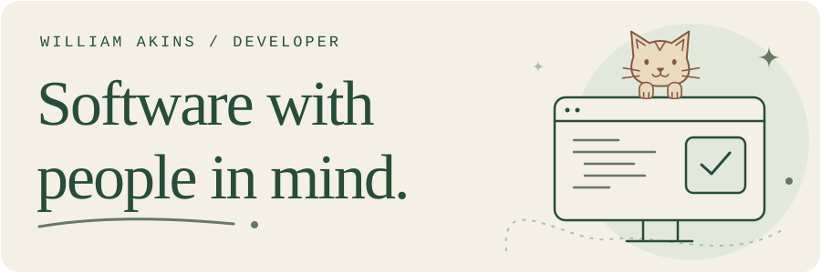
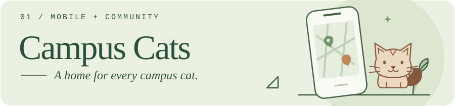
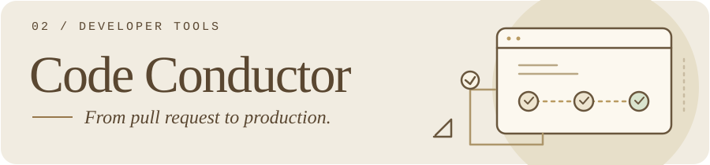
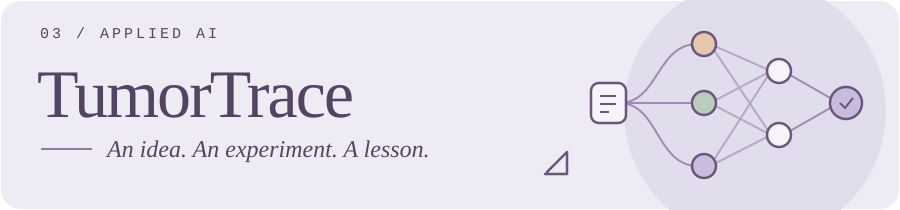

<picture>
  <source media="(prefers-color-scheme: dark)" srcset="assets/hello-dark.svg">
  
</picture>

### Hi, I'm William.

I build web and mobile products, developer tools, and applied AI. I start with the people behind a problem and work through the details that make a product useful.

**Currently at Croft:** Software Developer, turning complex agricultural filing workflows into approachable software with Ruby on Rails.

## A few things I've built

A mobile platform for college clubs to coordinate cat care and bring volunteers together. After our five-person Georgia Tech capstone, I continued as its sole developer, expanding it for separate college communities.

`React Native` `Expo` `TypeScript` `PostgreSQL` `Firebase`

I built a self-hosted tool that connects reviews, tests, deployments, and production health. Replaceable integrations let teams switch supported providers; careful failure handling keeps deployment state honest.

`Node.js` `PostgreSQL` `Provider integrations`

An educational MRI-classification study comparing three model families. I contributed preprocessing, model implementation, training, and evaluation as part of a three-person team. The interesting part is what the experiment taught us, including its limits.

`Python` `PyTorch` `Computer vision`

---

### The first click matters

In an early Campus Cats design review, I showed the club officers a Figma mockup. They stared at it in silence. The buttons were there, but nobody knew where to start.

That changed how I think about an interface. Now, whether I'm building for a cat-care club or farmers navigating filing paperwork at Croft, I ask: **Would someone opening this for the first time know what to do next?**
